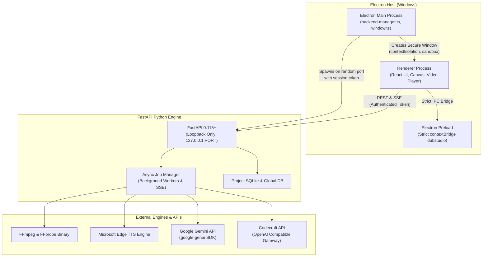

# DubStudio AI - System Architecture

## 1. Overview & Principles
DubStudio AI is an enterprise-grade Windows desktop application built for professional video dubbing, speech recognition, translation, audio synchronization, and video export. It is inspired by CapCut Desktop, VS Code, and modern nonlinear editors.

The architecture strictly separates responsibilities into three major layers:
1. **Desktop Shell & Security Host (Electron.js Main & Preload)**
2. **Interactive Nonlinear Editor (React 18 + TypeScript + Vite + Zustand)**
3. **High-Performance Media & AI Engine (Python 3.12 + FastAPI + SQLite + FFmpeg + Edge TTS)**

---

## 2. Process Architecture & Security Boundary



### Security Directives:
- **Renderer Isolation**: `contextIsolation: true`, `nodeIntegration: false`, `sandbox: true`.
- **Backend Authentication**: The Python FastAPI service binds to `127.0.0.1` on an OS-allocated random ephemeral port. Every request requires an `X-DubStudio-Token` generated dynamically via `crypto.randomUUID()` at application launch. No open external network exposure.
- **Credential Storage**: API keys are saved locally in the user application data directory and never exposed to public logs.

---

## 3. Project Storage Layout
Each project is self-contained and portable:
```text
<ProjectName>_<UUID>/
├── project.json            # Authoritative project manifest (schemaVersion 1.0.0)
├── database.sqlite         # Project-specific relational database
├── media/
│   ├── source/             # Imported video assets
│   ├── audio/              # Extracted 16kHz/24kHz PCM WAV dialogue tracks
│   └── generated/          # Edge TTS synthesized and time-stretched speech clips
├── transcripts/
│   └── transcript.json     # Timestamped speech-to-text segments
├── translations/
│   └── translation.json    # Target language translations
├── subtitles/
│   └── export.srt          # Formatted SRT & VTT subtitles
├── thumbnails/             # Filmstrip video thumbnails
├── waveform-cache/         # Peak amplitude JSON arrays for canvas rendering
├── preview-cache/          # Fast preview clips
├── exports/                # Rendered final dubbed MP4 videos
└── logs/                   # Rotating execution and FFmpeg logs
```

---

## 4. Audio Synchronization Strategy

Dubbed speech alignment operates under three synchronization profiles:

1. **Natural Mode**:
   - Preserves human speech cadence and timbre.
   - If audio duration differs from original video dialogue by less than 15%, speech rate is untouched (1.0x).
   - If deviation is larger, gentle speed adjustment (0.90x – 1.20x) is applied.

2. **Balanced Mode (Default)**:
   - Balances voice quality with timeline dialogue alignment.
   - Applies FFmpeg `atempo` time-stretching bounded between 0.75x and 1.40x.
   - Silence is appended (`apad`) or excess trimmed (`atrim`) to lock with original video dialogue bounds.

3. **Strict Sync Mode**:
   - Prioritizes exact timestamp matching.
   - Bounded between 0.50x and 2.0x, guaranteeing exact segment duration matching.

---

## 5. Media Pipeline & Subtitle Burn-In
The final export pipeline uses an FFmpeg filtergraph:
- `adelay` places each dubbed dialogue clip at its exact timeline offset in milliseconds.
- `volume` balances original video audio (e.g. 20%), dubbed speech (100%), and background audio (30%).
- `amix` composites all audio streams with dropout transition.
- `subtitles` filter burns in Unicode text rendered with the **Kantumruy Pro** font, ensuring correct Khmer script glyph rendering and combining marks.
- `-progress pipe:1` feeds real-time frame progress to the Electron frontend via Server-Sent Events (SSE).
