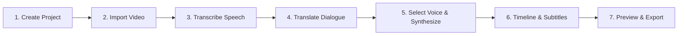

# DubStudio AI - User Guide & Workflow Manual

Welcome to **DubStudio AI**, the professional AI-powered video dubbing and translation studio for Windows.

---

## 1. Quick Start Workflow

Follow these simple steps to produce a finished dubbed video:

---

## 2. Step-by-Step Instructions

### Step 1: Create a Project
1. Launch **DubStudio AI**.
2. Click **New** in the top toolbar (or press `Ctrl+N`).
3. Enter a project name (e.g. `Tech Keynote Khmer Dub`).
4. Select the original dialogue language (e.g. `English`) and target language (e.g. `Khmer`).
5. Choose an Audio Synchronization mode:
   - **Balanced** (Recommended): Balances natural human speech cadence with segment alignment.
   - **Natural**: Keeps unmodified speech rate whenever timing is close.
   - **Strict Sync**: Prioritizes locking strictly to original video timing.
6. Click **Create Project**.

### Step 2: Import Video
1. Click **Import** in the toolbar or navigate to the **Media** tab on the left.
2. Drag and drop any video (`MP4`, `MOV`, `MKV`, `WebM`) into the import dropzone.
3. DubStudio AI automatically probes the video metadata, extracts the audio track into clean PCM WAV format, and generates waveform peak cache and video thumbnails.

### Step 3: Transcribe Video Speech
1. Switch to the **Transcript** tab in the left panel.
2. Select your speech recognition AI provider:
   - **Google Gemini** (Recommended for high accuracy).
   - **Codecraft API**.
3. Verify your source language and click **Transcribe Video Speech**.
4. The background job manager displays live progress in the top status bar.
5. Review the generated dialogue segments. You can edit text directly in the cards, split long segments, or merge contiguous dialogue.

### Step 4: Translate into Target Language
1. Switch to the **Translation** tab.
2. Choose your translation provider (Gemini or Codecraft).
3. Select your target language (`Khmer`, `Vietnamese`, `Thai`, `English`, etc.).
4. Click **Translate Dialogue**.
5. Once complete, inspect the translated dialogue. Any text you edit manually receives an **Edited** badge and will never be overwritten by automatic re-runs.

### Step 5: Audition Voices & Generate Speech
1. Switch to the **Voices** tab to preview natural Microsoft Edge TTS voices.
2. Filter by `Khmer (km-KH)` or other languages and click the **Play** button on any voice card to audition it.
3. Return to the **Translation** tab and click **Generate Speech**.
4. DubStudio AI automatically synthesizes the dubbed voice clips, measures audio duration, applies time-stretching and padding, and places clips into the **Dubbed Voice** timeline track.

### Step 6: Interactive Timeline & Subtitle Styling
1. Use the bottom multitrack timeline to review:
   - **Video Track**
   - **Original Audio Track** (with waveform visualization)
   - **Dubbed Voice Track** (with generated speech clips)
   - **Subtitles Track**
2. Scrub the playhead needle or press `Space` to play/pause in the video player.
3. Switch to the **Subtitles** tab in the left panel to configure the **Kantumruy Pro** font, font size, text color, outline thickness, and vertical alignment.
4. Live subtitles appear overlaid on the video player in real time.

### Step 7: Export Finished MP4 Video
1. Click **Export** in the top toolbar (or press `Ctrl+E`).
2. Choose your resolution preset: `720p`, `1080p Full HD`, `1440p 2K`, or `4K Ultra HD`.
3. Choose whether to burn in subtitles permanently using the Kantumruy Pro font, or export sidecar `.srt` / `.vtt` files.
4. Select your destination directory and click **Start Video Export**.
5. Watch real-time FFmpeg progress. When finished, click **Show in Explorer** to view your finished dubbed video.

---

## 3. Keyboard Shortcuts

| Shortcut | Action |
|---|---|
| `Space` | Play / Pause video player |
| `Ctrl+N` | Create new project |
| `Ctrl+I` | Import video file |
| `Ctrl+S` | Save project and timeline |
| `Ctrl+E` | Export finished video |
| `Ctrl+Z` | Undo timeline action |
| `Ctrl+Y` | Redo timeline action |
| `Ctrl+B` | Split selected clip at playhead |
| `Delete` | Delete selected clip from timeline |
| `+` / `-` | Zoom timeline in / out |
| `S` | Toggle timeline magnetic snapping |
| `Left / Right Arrow` | Step 1 frame backward / forward |
